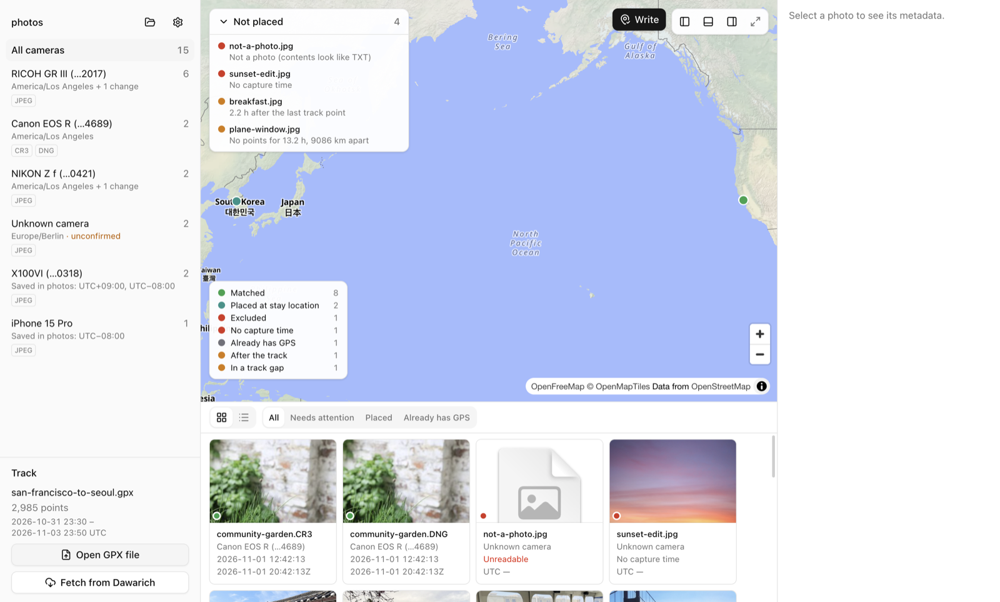
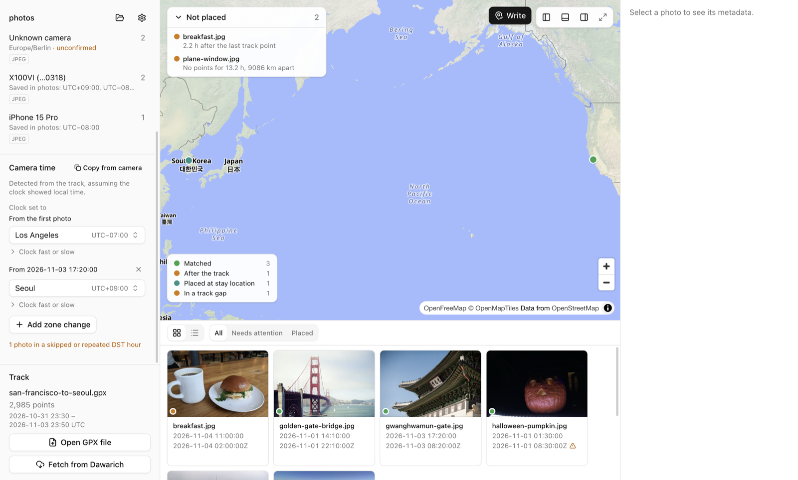
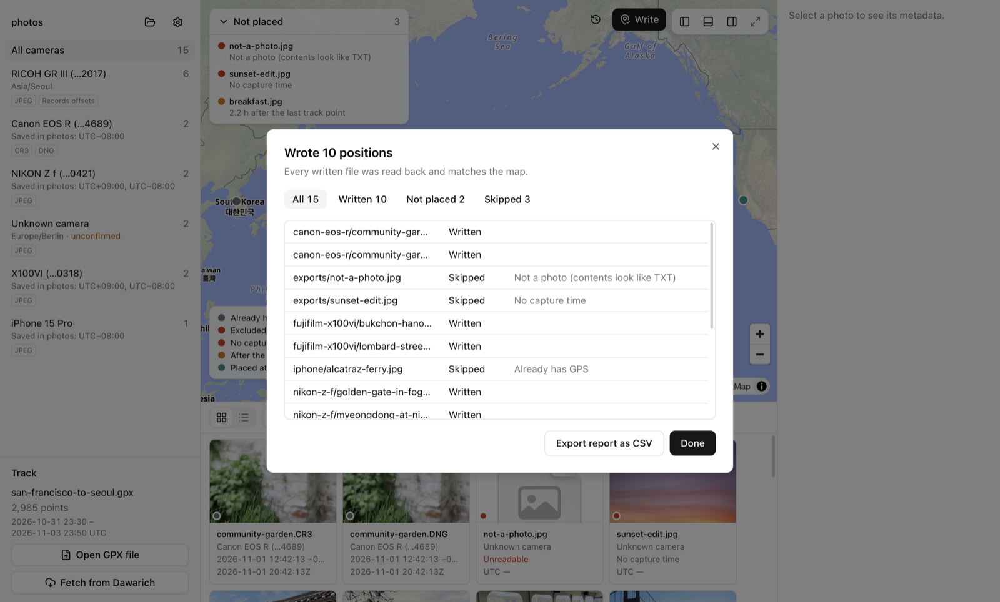

# Stecknadel

Stecknadel puts the right GPS position into your travel photos. It takes the location history your phone recorded during the trip and works out where each photo was taken. (Stecknadel is German for a pin.)



It works in four steps:

1. Open a folder of photos.
2. Load your track: a GPX file, or your history from a Dawarich server.
3. Check that each camera's clock is set to the right time zone. Stecknadel suggests the zones from the track.
4. Look at the map, fix the photos that need it, and click **Write**.

Every position comes from ExifTool, the standard tool for photo metadata. The map shows exactly what ExifTool will write, before anything is written.

## Contents

- [Install](#install)
- [What you need](#what-you-need)
- [Three things to understand first](#three-things-to-understand-first)
- [Your first trip](#your-first-trip)
- [Photo statuses](#photo-statuses)
- [Camera time](#camera-time)
- [Fix a photo that landed in the wrong place](#fix-a-photo-that-landed-in-the-wrong-place)
- [Write the positions](#write-the-positions)
- [Undo a write](#undo-a-write)
- [The track](#the-track)
- [Find photos quickly](#find-photos-quickly)
- [Panels and keyboard](#panels-and-keyboard)
- [Settings](#settings)
- [Updates](#updates)
- [What is saved on your computer](#what-is-saved-on-your-computer)
- [Your privacy](#your-privacy)
- [If something looks wrong](#if-something-looks-wrong)
- [Known limits](#known-limits)
- [Development](#development)
- [License](#license)

## Install

Download the latest version from the [Releases page](https://github.com/LekoArts/stecknadel/releases).

| System                | File                                | Notes                                                                |
| --------------------- | ----------------------------------- | -------------------------------------------------------------------- |
| Windows               | `Stecknadel-<version>-setup.exe`    | Installs for your user and updates itself.                           |
| Windows, no install   | `Stecknadel-<version>-portable.exe` | Runs from any folder. Tells you when a new version exists.           |
| macOS (Apple silicon) | `Stecknadel-<version>.dmg`          | Drag the app into Applications. Tells you when a new version exists. |

The builds are not signed, so your system warns you the first time you open them.

- **Windows:** SmartScreen says "Windows protected your PC". Click **More info**, then **Run anyway**.
- **macOS:** Gatekeeper says the app cannot be opened. Right-click the app in Applications, choose **Open**, then click **Open** again. If macOS still refuses, run this once in Terminal:

  ```sh
  xattr -dr com.apple.quarantine /Applications/Stecknadel.app
  ```

## What you need

- **Your photos.** JPEG, HEIC, HEIF, CR3, NEF, NRW, ARW, SR2, RAF and DNG files.
- **A location track** covering the trip. Either a GPX file from your phone or another app, or a [Dawarich](https://dawarich.app) server. Dawarich is a self-hosted app that records where you have been.
- **For Dawarich: an API key.** In Dawarich, open your account settings. The API key is shown there.

## Three things to understand first

1. **Your photos.** Each file records when it was taken and which camera took it. Most files have no position.
2. **Your track.** A track is a long list of points. Each point has a time, a latitude and a longitude. Your phone records one every few seconds or minutes.
3. **Your camera's clock.** To find a photo on the track, Stecknadel needs the photo's exact time in UTC, the world time standard. Most cameras only store the local time on their clock. So Stecknadel needs to know which time zone the clock was set to. If that is wrong, the photo lands in the wrong place.

## Your first trip

1. Open Stecknadel and click **Open folder**. Choose the folder with the trip's photos. Stecknadel also looks in its subfolders.
2. In the **Track** section at the bottom left, click **Open GPX file**, or click **Fetch from Dawarich** and enter your server address, API key and the trip's dates.
3. Look at the cameras in the left sidebar. Each one shows the time zone Stecknadel believes its clock was set to, for example "Los Angeles + 1 change". Click a camera to check it. See [Camera time](#camera-time).
4. The map fills with pins, and each photo gets a coloured status dot. The legend at the bottom left of the map counts the photos per status.
5. Click a photo to see its pin on the map and its metadata on the right.
6. Fix the photos that need attention. See [Fix a photo that landed in the wrong place](#fix-a-photo-that-landed-in-the-wrong-place).
7. Click **Write** at the top right of the map.

## Photo statuses

Every photo has one status. It appears as a coloured dot in the grid, in the list and in the map legend.

| Status                    | What it means                                                                                                 | Written? |
| ------------------------- | ------------------------------------------------------------------------------------------------------------- | -------- |
| Matched                   | The photo's time falls between two nearby track points.                                                       | Yes      |
| Placed at stay location   | The photo was taken during a long stop, such as a night in a hotel. It gets the position of that stop.        | Yes      |
| Placed by hand            | You chose the position on the map.                                                                            | Yes      |
| Already has GPS           | The file already has a position. Stecknadel keeps it unless you turn on replacing it in Settings.             | No       |
| Before the track          | The photo was taken before the first track point.                                                             | No       |
| After the track           | The photo was taken after the last track point.                                                               | No       |
| In a track gap            | The track has no points around the photo's time, for example during a flight.                                 | No       |
| Outside the fetched range | You fetched only part of the trip from Dawarich.                                                              | No       |
| No capture time           | The file has no date and time.                                                                                | No       |
| Excluded                  | Stecknadel will not touch this file. For example, it cannot be read, or two RAW files share one sidecar name. | No       |

Photos that are not written can still be placed by hand, unless they are excluded.

## Camera time



Click a camera in the left sidebar to see its time settings under **Camera time**.

- **Clock set to.** The time zone the camera's clock showed. Stecknadel suggests it from the track, assuming you set the clock to local time. Pick another zone from the list, or choose a fixed UTC offset such as UTC+02:00.
- **Zone changes.** If you changed the clock during the trip, click **Add zone change**. Choose the first photo taken in the new zone, then the new zone.
- **Clock fast or slow.** Camera clocks drift. Enter how many seconds the clock was ahead or behind, and choose **Fast** or **Slow**. The offset finder can fill this in.
- **Saved in photos.** Some cameras save the time zone offset in each photo. Stecknadel uses it. If it disagrees with the zone you chose, the photo shows a warning.
- **Copy from camera.** If two cameras were set the same way, copy one camera's zones and zone changes to the other. Each camera keeps its own clock drift.

A camera marked **unconfirmed** uses your computer's time zone, because nothing better was found. Check it before you write.

Camera time settings last until you close the app. Camera names are kept: hover over a camera and click the pencil to rename it.

## Fix a photo that landed in the wrong place

Select the photo. Its actions appear on the map.

### Find the clock offset

Use this when a photo lands near the right place but not on it. Usually the camera's zone or clock was off, and all of that camera's photos are off in the same way.

1. Click **Find offset**.
2. Click the map where the photo was really taken.
3. Stecknadel lists the clock settings that would put the photo there, with the time zone, the clock drift and the distance.
4. Click **Apply** on the right one. All photos from that camera move.

### Place a photo by hand

Use this when no clock setting can help, for example for a photo taken on a plane.

1. Click **Place on map**.
2. Click where the photo was taken.

### Copy another photo's position

1. Select the photo that needs a position and click **Copy location**.
2. Click the pin of a photo that is in the right place. The selected photo gets its position.

## Write the positions



1. Click **Write** at the top right of the map.
2. Stecknadel shows how many photos it will write, per status, and the writing options from Settings. Click **Write**.
3. Don't move or edit the photos while it writes.
4. The report lists every photo with its result: written, failed, not placed, or skipped. Use the filters to see one group. Click **Export report as CSV** to save it.

What Stecknadel writes:

- The latitude, longitude and, when the track has it, the altitude.
- For JPEG and HEIC files, into the file itself.
- For RAW files, into the RAW file or into an `.xmp` sidecar file next to it. You choose this in Settings.
- The photo's time zone offset (`OffsetTimeOriginal`), so other apps show the right local time. Stecknadel never replaces an offset the photo already has. You can turn this off in Settings.

Before it writes, Stecknadel checks that each file has not changed since you loaded it. After it writes, it reads every file back and compares the position with the map. A photo that does not match is reported as failed.

If the camera settings or the track changed while the map was still updating, Stecknadel stops and asks you to check the map again.

## Undo a write

Click the history button (a clock with an arrow) next to **Write** to see **Recent writes**.

| Action                | What it does                                                                                                                                                                                                                                     |
| --------------------- | ------------------------------------------------------------------------------------------------------------------------------------------------------------------------------------------------------------------------------------------------ |
| **Restore values**    | Puts back the GPS and time zone values the files had before the write, and removes sidecar files the write created.                                                                                                                              |
| **Restore originals** | Replaces the edited files with their `<file>_original` copies. ExifTool keeps only the oldest copy, so if one was already there from another tool, that older copy comes back. Only available when **Keep a copy of each original file** was on. |
| **Delete copies**     | Deletes those copies to free space.                                                                                                                                                                                                              |
| **Forget**            | Removes the write from the list.                                                                                                                                                                                                                 |

A file you edited in another app after the write is left alone.

If Stecknadel stopped in the middle of a write, for example because the computer shut down, the write is marked "Stopped before it finished". Stecknadel cannot tell which of those files you edited since, so it asks before it restores them. If you confirm, it puts back the old values in every file of that write, even ones you changed afterwards, and removes the sidecar files the write created.

## The track

- **GPX file.** Click **Open GPX file**. Stecknadel reads track points and waypoints and tells you about points it had to skip.
- **Dawarich.** Click **Fetch from Dawarich**. Enter the server address, your API key, and the start and end of the trip in UTC. Click **Test connection** to check the address and key. Your key is stored encrypted and is not shown again.
- **Fetch a wider range.** When photos were taken outside the fetched dates, a bar above the photos says so. Click **Fetch wider range**. The dates are already filled in.

**Long stops.** When the track stays in one place for a long time, such as a night in a hotel, the phone often records no points. Stecknadel treats such a stop as one place, so photos taken there are placed.

**Flights.** When the track jumps far between two points, Stecknadel does not guess. Photos taken in between show "In a track gap". Place them by hand.

## Find photos quickly

**Cameras.** The left sidebar lists every camera with its photo count. Click a camera to show only its photos. Click **All cameras** to show all.

**Grid and list.** The toolbar above the photos switches between a grid and a list. In the list, click a column heading to sort by it. Click it again to reverse the order.

**Status filters.** **Needs attention** shows the photos without a position and the photos with a time warning. **Placed** shows the photos that will be written. **Already has GPS** shows the photos that keep their position.

**Metadata.** The right panel shows every tag ExifTool reads from the selected photo. Type in the filter box to find a tag.

Click an empty spot in the photo area, or press Escape, to clear the selection.

## Panels and keyboard

Drag the edge between two panels to resize them. Drag a panel past its smallest size to close it. When you open it again, it has its earlier size.

| Action                        | Mac         | Windows      |
| ----------------------------- | ----------- | ------------ |
| Show or hide the cameras      | Cmd+1       | Ctrl+1       |
| Show or hide the photos       | Cmd+2       | Ctrl+2       |
| Show or hide the metadata     | Cmd+3       | Ctrl+3       |
| Show only the map, or go back | Cmd+0       | Ctrl+0       |
| Reset the zoom of the window  | Cmd+Shift+0 | Ctrl+Shift+0 |

The same actions are in the **View** menu and in the buttons at the top right of the map. Stecknadel remembers your panels for the next start.

## Settings

Click the gear button at the top of the left sidebar.

| Setting                                                       | Key in `settings.json`         | What it does                                                                                                  | Default     |
| ------------------------------------------------------------- | ------------------------------ | ------------------------------------------------------------------------------------------------------------- | ----------- |
| Interpolate between points up to                              | `matching.geoMaxIntSecs`       | The longest time between two track points that a photo may be placed between.                                 | 30 minutes  |
| Use the nearest point up to                                   | `matching.geoMaxExtSecs`       | The longest time between a photo and the nearest track point, when the photo is not between two close points. | 30 minutes  |
| Bridge gaps where the track starts and ends at the same place | `matching.bridge.enabled`      | Whether long stops are filled in, see [The track](#the-track).                                                | On          |
| Within                                                        | `matching.bridge.radiusMeters` | How close the points before and after a stop must be.                                                         | 250 m       |
| Gaps up to                                                    | `matching.bridge.maxGapHours`  | The longest stop that is filled in.                                                                           | 24 hours    |
| Replace GPS positions photos already have                     | `writing.overwriteGps`         | Write photos that already have a position.                                                                    | Off         |
| Write the time zone offset (OffsetTimeOriginal)               | `writing.writeOffsetTime`      | Also save the time zone offset into each written photo.                                                       | On          |
| Keep a copy of each original file                             | `writing.backups`              | Keep `<file>_original` next to each edited file, so you can restore it.                                       | Off         |
| For RAW files, write into                                     | `writing.rawTarget`            | The RAW file itself (`in-file`), or an `.xmp` sidecar next to it (`sidecar`).                                 | RAW file    |
| Map                                                           | `mapSource`                    | OpenFreeMap (needs internet), your own map style address, or a local PMTiles file that works offline.         | OpenFreeMap |

`settings.json` also keeps the Dawarich server address you saved (`dawarichUrl`). The API key is never in this file.

## Updates

Stecknadel checks GitHub for a new version when it starts and every six hours.

- **Windows installer:** the update downloads in the background. A notice offers **Restart to install**.
- **Windows portable and macOS:** a notice links to the new version on the Releases page.

## What is saved on your computer

Stecknadel keeps its files in `~/Library/Application Support/Stecknadel` on macOS and `%APPDATA%\Stecknadel` on Windows.

| File            | Contents                                                                          |
| --------------- | --------------------------------------------------------------------------------- |
| `settings.json` | Your settings.                                                                    |
| `cameras.json`  | The names you gave your cameras.                                                  |
| `secrets.bin`   | Your Dawarich API key, encrypted by your system.                                  |
| `journal/`      | A record of each recent write, so it can be undone.                               |
| `thumbs/`       | Small copies of your photos for the grid. You can delete this folder at any time. |

## Your privacy

- Your photos and your track stay on your computer. Stecknadel uploads nothing.
- Stecknadel only connects to the Dawarich server you enter, the map server you choose and GitHub, to check for updates.
- Your API key is encrypted by your system and is never shown in the window.
- Stecknadel only accepts a plain `http://` Dawarich address for a server on your computer or your local network.

## If something looks wrong

| What you see                                       | What to try                                                                                |
| -------------------------------------------------- | ------------------------------------------------------------------------------------------ |
| No pins on the map                                 | Load a track.                                                                              |
| All photos from one camera are in the wrong area   | That camera's time zone is wrong. Pick the right one, or use **Find offset** on one photo. |
| A camera's photos are a little off along the route | The clock was fast or slow. Use **Find offset**.                                           |
| A photo is "In a track gap"                        | The phone recorded nothing then. Use **Place on map**.                                     |
| A photo is "Outside the fetched range"             | Click **Fetch wider range**.                                                               |
| **Write** is greyed out                            | No photo has a position to write yet.                                                      |
| The report shows a failed photo                    | Read its message. Common causes: the file is read-only, or it changed after you loaded it. |
| A HEIC photo has no thumbnail                      | The pin, status and metadata still work.                                                   |

## Known limits

- Builds are only made for Windows (x64) and macOS (Apple silicon).
- The builds are not signed. See [Install](#install).
- Camera time settings are not kept after you close the app.
- Some HEIC files show no thumbnail.

## Development

Stecknadel is an Electron app. The window uses React, TypeScript, Tailwind and shadcn/ui. The map uses MapLibre. All photo work goes through ExifTool, via exiftool-vendored.

You need Node.js 22 or newer, pnpm 11, and macOS or Windows.

```sh
pnpm install
pnpm fixtures   # download the pinned test photos
pnpm dev        # start the app with live reload
```

| Command              | What it does                                                                                                                |
| -------------------- | --------------------------------------------------------------------------------------------------------------------------- |
| `pnpm lint`          | Check formatting and lint rules.                                                                                            |
| `pnpm typecheck`     | Check the TypeScript types.                                                                                                 |
| `pnpm test`          | Run the unit tests.                                                                                                         |
| `pnpm test:native`   | Run the tests that call the real ExifTool.                                                                                  |
| `pnpm test:e2e`      | Run the end-to-end tests against the packaged app. Build it first: `pnpm build && pnpm package:mac:dir`.                    |
| `pnpm make-fixtures` | Generate the test JPEGs.                                                                                                    |
| `pnpm make-demo`     | Create a made-up trip from San Francisco to Seoul with a GPX track and photos for every case. It prints the folder to open. |
| `pnpm package:mac`   | Build the macOS disk image. Run `pnpm build` first.                                                                         |
| `pnpm package:win`   | Build the Windows installer and portable app. Run `pnpm build` first, on Windows.                                           |

### Release

Releases use [Changesets](https://github.com/changesets/changesets).

1. With each user-facing change, run `pnpm changeset` and describe the change. Commit the file it creates.
2. When changes reach `main`, the Release workflow opens or updates a pull request called "Release: version". It raises the version and updates `CHANGELOG.md`.
3. Merge that pull request to release. The workflow tags the version, builds Windows and macOS, tests the installed apps, and publishes them as a GitHub Release.

To test a release build without publishing, run the **Build release** workflow by hand with **dry-run** on. To retry a failed publish, run it with the tag and **dry-run** off.

## License

[MIT](LICENSE)
